# Tiny Gallery

A small, fast photo gallery for **one photographer**, running entirely on Cloudflare's free tier:
Pages for the site, Pages Functions for the API, **D1** for the database and **R2** for the photos.
No framework, no build step, nothing to install: about 4,700 lines of plain JavaScript, HTML and CSS, plus two small vendored libraries for QR codes and ZIP files.

Minimal dark design: full-screen covers, a masonry grid, a clean photo viewer,
easy downloads, and private album links you can share with anyone.

**Live demo:** <https://tinygallery.pages.dev/>
**Private folder (demo):** <https://tinygallery.pages.dev/f/RtcvX8TEzivg>

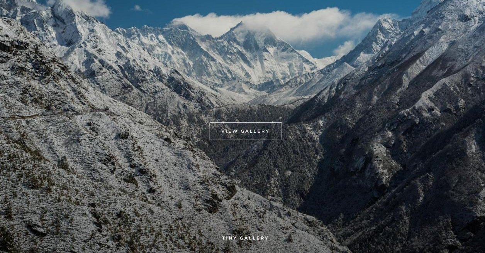

| Albums on the home page | Private folder |
|---|---|
| 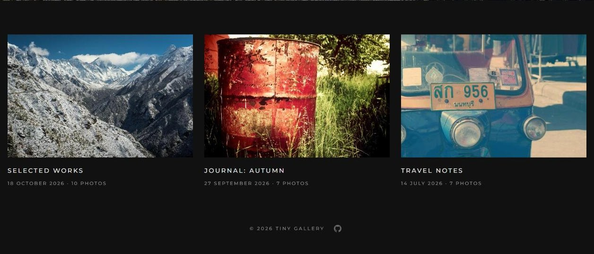 | 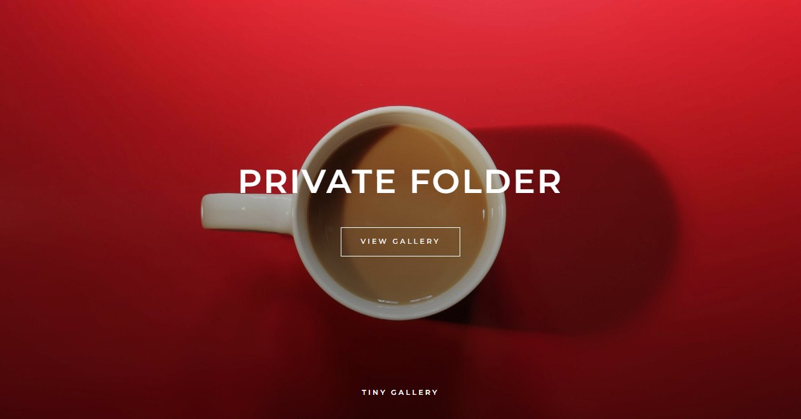 |
| **Album grid with Download all** | **Photo viewer with slideshow, share, download and zoom** |
| 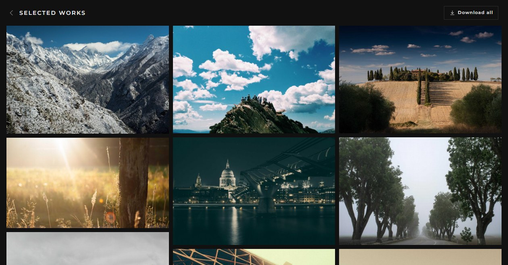 | 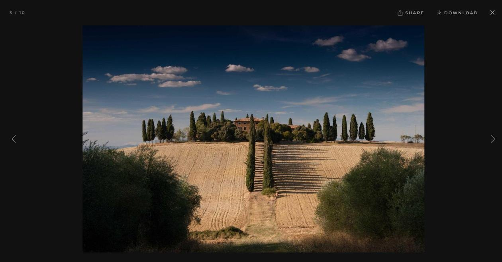 |

**On a phone:** cover, album grid and viewer.

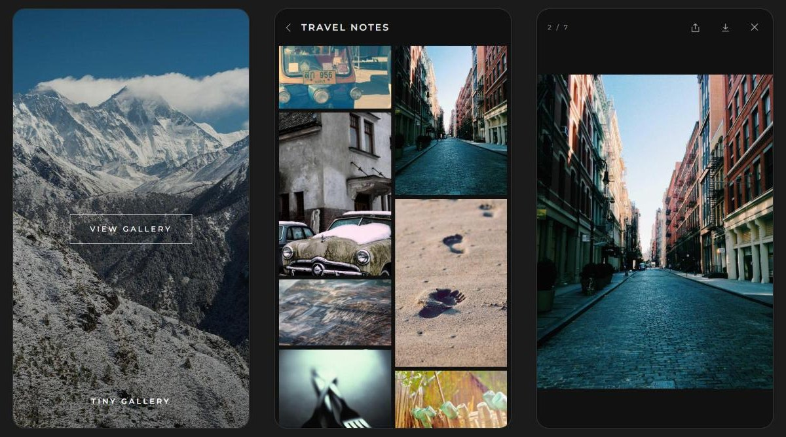

**Slideshow** for a TV at a party: speed, shuffle and a QR code guests can scan to open the album.

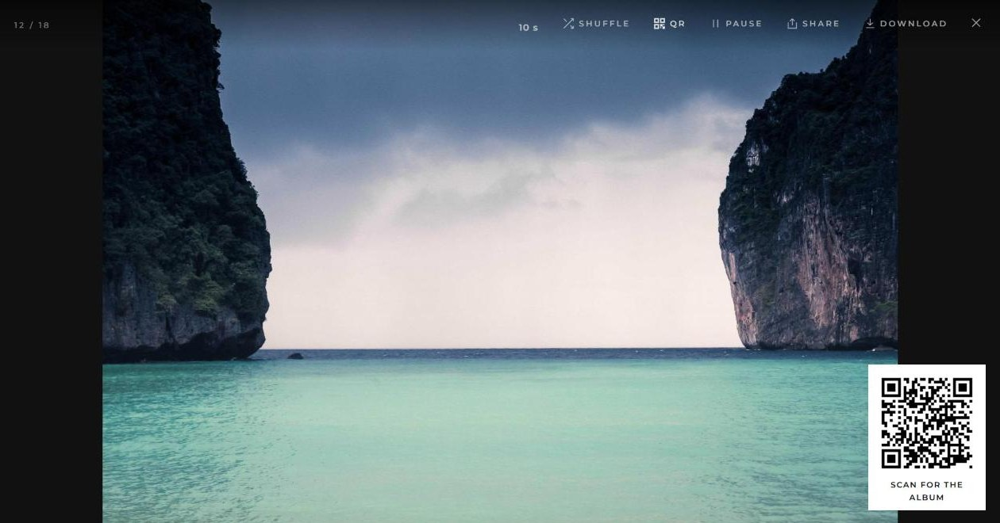

**Admin panel** at `/admin`:

| Settings and home page | Albums, drag to reorder |
|---|---|
| 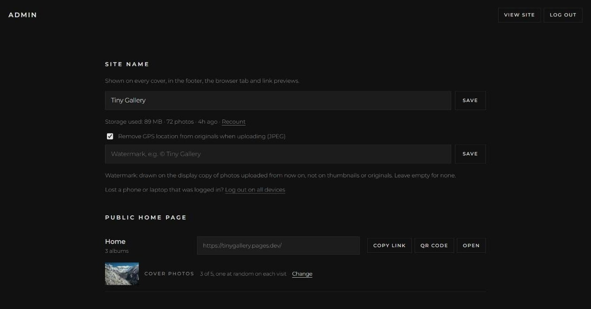 | 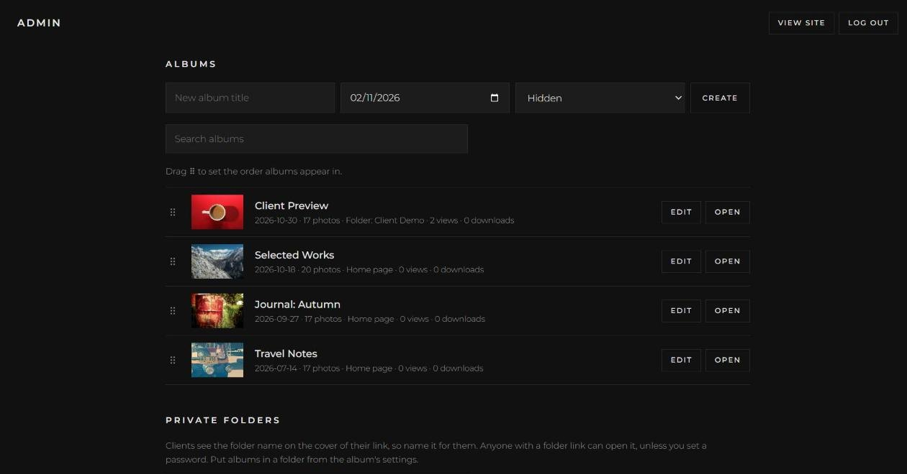 |
| **Private folder: link, QR code, password, expiry, downloads, favourites** | **Album: upload, select to move or delete, reorder** |
| 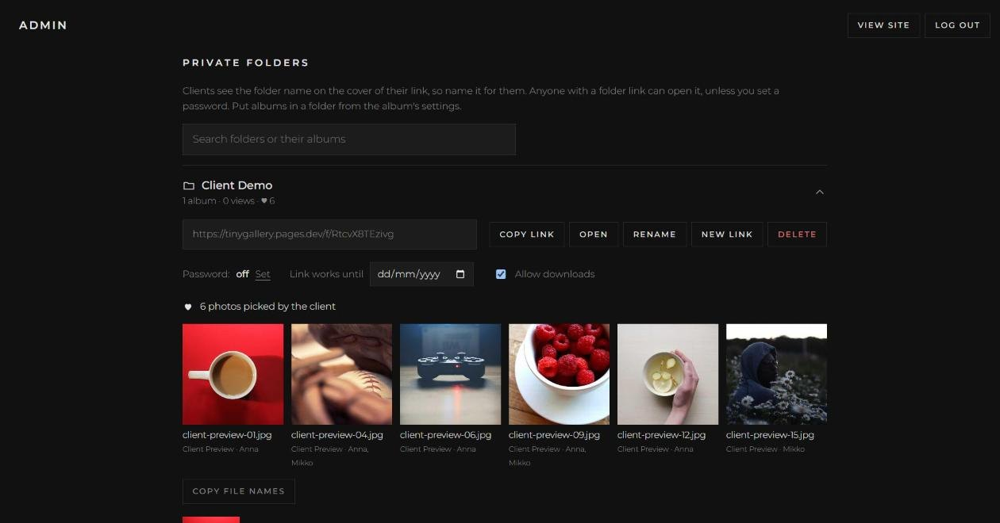 | 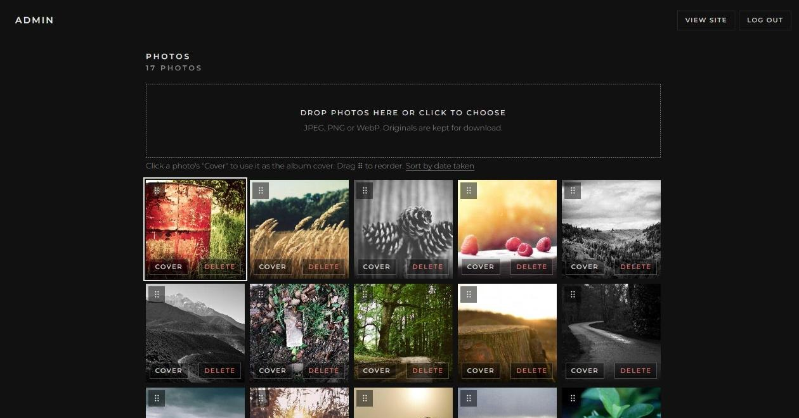 |

**Trash:** deleted photos and albums can be restored for 7 days.

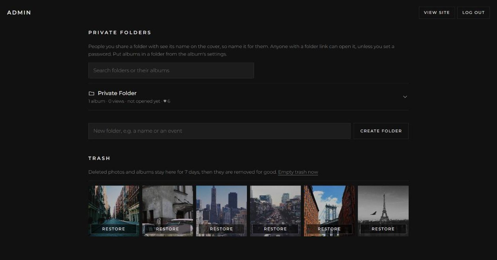

---

## Contents

- [Features](#features)
- [How it works](#how-it-works)
- [Deploy your own](#deploy-your-own)
- [Local development](#local-development)
- [Costs and limits](#costs-and-limits)
- [Custom domain and moving accounts](#custom-domain-and-moving-accounts)
- [Security and privacy](#security-and-privacy)
- [Known limitations](#known-limitations)
- [Project structure](#project-structure)
- [Credits](#credits) · [License](#license)

---

## Features

**For visitors**
- Full-screen cover with the site name, then album cards; each album opens with its own cover.
- Masonry grid that keeps left-to-right order (2 columns on phones, 3 on laptops, 4 on large screens).
- Photo viewer with keyboard arrows, swipe, **pinch / double-tap / wheel zoom** and drag to pan.
  Past the display resolution it quietly loads the original, so zoomed detail stays sharp.
- **Download** the original with its original file name, from the grid (hover) or the viewer.
- **Slideshow** button in the viewer: full screen, loops forever and keeps the screen awake, so a TV or laptop
  can show an album at a party or wedding. While it plays: **3, 5 or 10 seconds** per photo, **Shuffle** (every
  photo once before repeating) and a **QR code** in the corner so guests can open the album on their phones.
  A tap shows the controls, a second tap, Esc or Space stops it. The choices are remembered in that browser.
- **Download all** as one ZIP of the originals (or only the favourites while that filter is on), made in the
  browser. Chrome and Edge on a computer write it straight to disk; elsewhere it is built in memory first.
- **Share** button: the device's own share sheet (phones, Safari, Chrome, Edge), copy-link fallback elsewhere.
- **Link previews** (WhatsApp, Messenger, Slack, ...) with title, description and cover photo.
- Big albums load 100 photos at a time as you scroll.
- Self-hosted Montserrat font: no Google Fonts, no trackers. Cookies only for unlocking a password-protected folder.

**For people you share a private folder with**
- **Favourites:** a heart on each photo and in the viewer, an optional name asked once, and a **♥ N** button
  that shows only the picked photos. No account needed; picks are kept per browser.
- Optional **password** and **expiry date** per folder, set by the photographer.

**For the photographer (admin at `/admin`)**
- One admin account, one password (a Cloudflare secret). No sign-ups, no user management.
- Albums with title and date, shown on the **home page**, **hidden**, or inside a **private folder**.
- **Drag to reorder** albums and photos (mouse or touch), and **Sort by date taken** (read from EXIF at upload).
- Drag-and-drop upload of many photos at once, **3 at a time**, kept in the order chosen. The browser makes the
  display (2400 px) and thumbnail (900 px) copies, the original is kept for download.
- **No duplicates:** the same file is never added twice to one album (SHA-256 fingerprint checked in the browser
  and on the server). Photos uploaded before fingerprints existed are matched by file name and size.
- Optional **watermark** text on the display copies of new uploads (thumbnails and originals stay clean).
- **Select photos** in the album editor to **move** them to another album or **delete** many at once.
- **Trash:** deleted photos and albums stay **7 days** and can be restored, then they are removed for good.
- **Remove GPS location** from originals before upload (on by default): blanks the location in EXIF and XMP,
  keeps the date and everything else.
- **Private folders** to share with clients, friends or family: an unguessable link (`/f/<12 random characters>`), listed like
  albums, each with its own page: its albums and **+ New album**, **New link** to revoke, optional **password**, **link expiry date**, a **QR code** (PNG to save or print),
  **when it was last opened**, and the **favourites** people picked (thumbnails, who picked them, and
  **Copy file names** for your editing software).
- **Downloads switch** per album and per folder (on by default). Off hides the buttons and stops serving
  originals, so zoom stays at the display resolution.
- **Views and downloads** per album, views and favourites per folder (your own visits are not counted).
- **Cover photos:** up to 5 for the home page (one shown at random on each visit), one per folder and per album.
  Every choice saves at once; the current album cover is marked in the photo grid. Any photo can be a
  cover: the chooser loads one album's photos at a time, only when opened, so the admin stays fast.
- **Open** any photo in the album editor for a quick full-size preview (arrow keys to browse).
- Search for albums and folders (ignores accents: "seinajoki" finds "Seinäjoki").
- Site name setting, storage used (with on-demand recount) and photo count. A recount also removes files left by
  uploads that never finished (closed tab, lost connection) once they are a day old.
- **Log out on all devices**, for a lost phone or laptop.

---

## How it works

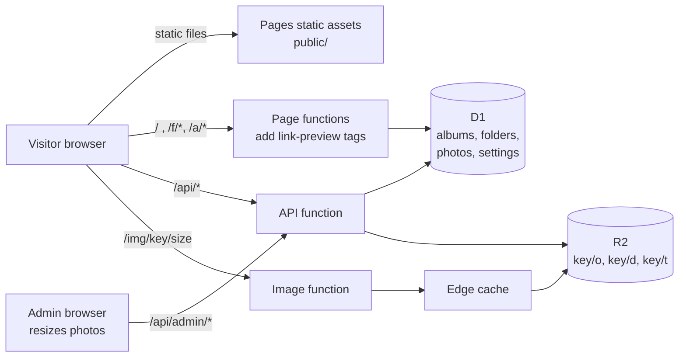

### Pieces

| Piece | What it does |
|---|---|
| `public/` | Static site served by Cloudflare Pages: one HTML shell for all public pages (`index.html`), the admin (`admin.html`), `app.js`, `admin.js`, `style.css`, fonts. Pages renders it in the browser. |
| `functions/api/[[path]].js` | JSON API. Public: `/api/home`, `/api/f/<token>`, `/api/album/<slug>`. Admin: everything under `/api/admin/*`. |
| `functions/img/[[path]].js` | Serves photos from R2 at `/img/<key>/<t\|d\|o>` (thumb, display, original), with year-long immutable caching and an edge cache. `?dl` forces a download with the original file name. |
| `functions/index.js`, `functions/f`, `functions/a` | Return the same HTML shell with Open Graph tags filled in on the server, because chat apps do not run JavaScript. |
| `lib/` | Shared code: page data and access rules (`data.js`), link previews (`og.js`), sessions and helpers (`util.js`). |
| **D1** (SQLite) | `albums`, `folders`, `photos`, `favorites`, `settings`, `login_attempts`. See [`schema.sql`](schema.sql); upgrades in [`migrations/`](migrations). |
| `scripts/setup.mjs` | One-command setup on your Cloudflare account. |
| **R2** | Three files per photo under a random 20-character key: `<key>/o` original, `<key>/d` display JPEG, `<key>/t` thumbnail JPEG. |

### URLs

| URL | Page |
|---|---|
| `/` | Home: public albums (folder_id empty and not hidden) |
| `/a/<slug>` | Public album |
| `/f/<token>` | Private folder: its albums, with the folder name on the cover |
| `/f/<token>/<slug>` | Album inside a private folder |
| `/admin` | Admin panel |

### Uploads

Resizing happens **in the admin's browser** (canvas, EXIF orientation applied), so the server never decodes
images and stays far below the 10 ms CPU limit of the free plan. The browser also adds the optional watermark to
the display copy and works out a SHA-256 fingerprint of the file. Photos upload 3 at a time, each in three steps:

1. `POST /api/admin/albums/<id>/photos` with the fingerprint returns a new random key, or `409` when the same file
   is already in the album (it is skipped).
2. `PUT /api/admin/upload/<key>/<t|d|o>` streams each file straight into R2 (the function never reads the bytes).
3. `POST /api/admin/albums/<id>/photos/<key>` checks all three files exist and adds the photo to the album.

A 22 MB original uploads in a few seconds this way.

### Access rules

- A **public** album opens for everyone.
- An album in a **private folder** opens only with that folder's token in the URL, otherwise "Not available".
- A folder with a **password** asks for it first; the right password sets a signed cookie for 30 days.
  Changing the password locks out everyone who used the old one.
- After its **expiry date** a folder shows "Link expired".
- Locked and expired folders never reveal their name or cover, not even in link previews.
- **Hidden** albums are visible to the admin only.
- Deleting a folder makes its albums **hidden**, never public, so nothing private leaks onto the home page.
- The admin can preview any album.
- Photos and albums in the **trash** are gone from every page; their originals are not served (thumbnails stay
  reachable only to someone who already has their random address) until restored or removed for good.

---

## Deploy your own

You need a Cloudflare account (free plan is fine), Node.js 18+ for `npx`, and R2 enabled in the dashboard
(R2 asks for a payment method even on the free tier).

```bash
git clone https://github.com/t0ma5/tinygallery.git
cd tinygallery
npx wrangler login
```

### One command

```bash
node scripts/setup.mjs
```

It asks for a project name, site name and footer link, then creates the D1 database and R2 bucket, writes
`wrangler.toml`, creates the tables and the Pages project, asks you to type the admin password, and deploys.
Afterwards open `https://<name>.pages.dev/admin`.

(Cloudflare's "Deploy to Cloudflare" button only supports Workers projects; Tiny Gallery is a Pages project,
so the script does that job.)

### By hand

1. **Create the database and the bucket.** Use your own names if you like.
   ```bash
   npx wrangler d1 create tinygallery
   npx wrangler r2 bucket create tinygallery
   ```
2. **Edit `wrangler.toml`**: set `name` (your Pages project, it becomes `<name>.pages.dev`),
   `database_id` (printed by the previous step), `bucket_name`, and the default site name in `PHOTOGRAPHER`.
3. **Create the tables.**
   ```bash
   npx wrangler d1 execute tinygallery --remote --file schema.sql
   ```
4. **Create the Pages project.** The `--force` flag makes a classic Pages project with a `pages.dev` address.
   ```bash
   npx wrangler pages project create tinygallery --production-branch main --force
   ```
5. **Set the admin password.** You type it at the prompt; it is stored encrypted at Cloudflare.
   ```bash
   npx wrangler pages secret put ADMIN_PASSWORD --project-name tinygallery
   ```
6. **Deploy.** Run this again after every change, and after changing the password.
   ```bash
   npx wrangler pages deploy --project-name tinygallery --branch main
   ```
7. Open `https://<name>.pages.dev/admin`, log in, set the site name, create albums and upload.

To remove the GitHub icon from the footer, delete the `REPO_URL` line in `wrangler.toml` and deploy again.

### Updating an existing install

Pull the new code, apply any new file in `migrations/` once, then deploy:

```bash
npx wrangler d1 execute <database> --remote --file migrations/0003_counts_trash.sql
npx wrangler pages deploy --project-name <name> --branch main
```

- `0002_features.sql` adds ordering, favourites, folder passwords, expiry, view and download counts and the
  download switches.
- `0003_counts_trash.sql` adds stored photo counts (so pages no longer read every photo row, which used up the
  free plan's daily database reads on big galleries), the trash, "last opened" for folders and duplicate detection.

Apply them in order, each once. Back up first: `npx wrangler d1 export <database> --remote --output backup.sql`.

---

## Local development

```bash
echo "ADMIN_PASSWORD=pick-a-local-test-password" > .dev.vars
npx wrangler d1 execute tinygallery --local --file schema.sql
npx wrangler pages dev public
```

Wrangler simulates D1 and R2 on your machine (`.wrangler/`), so local uploads never touch Cloudflare.
`.dev.vars` and `.wrangler/` are git-ignored.

**Tests:** with the local server running, `npm test` runs about 40 checks of the API: access rules, passwords,
expiry, downloads switch, favourites, uploads and duplicates, move, trash and restore, sessions. It refuses to run
against anything but `127.0.0.1` or `localhost` and removes only what it created.

---

## Costs and limits

**R2** (standard storage class) has no egress fees: views and downloads never cost bandwidth.

| | Free per month | After that |
|---|---|---|
| Storage | 10 GB | $0.015 per GB-month |
| Reads (Class B: each photo served from R2) | 10 million | $0.36 per million |
| Writes (Class A: 3 per uploaded photo, 1 per 1,000 files on a storage recount) | 1 million | $4.50 per million |

Originals take most of the space: a 24 MP JPEG is about 8 to 12 MB, so roughly 1,000 photos fit in 10 GB.
The edge cache keeps repeat views from reading R2 again.

**Pages Functions** (free plan): **100,000 requests a day** and 10 ms CPU per request. Every photo shown is one
function request (thumbnails, full photos, downloads), so the free plan handles roughly 1,100 visitors a day who
each scroll through an album and open ten photos (about 90 requests each). Returning visitors cost little: photos
stay in the browser cache for a year. Over the limit, every page and photo fails until 00:00 UTC (nothing is
billed). The limit is per Cloudflare account, shared by all sites on it. Workers Paid ($5/month) gives 10 million
requests a month with no daily cutoff. For very busy sites, serving photos straight from R2 on a custom domain
avoids function requests for images.

**D1** free limits: 5 GB, 5 million rows read and 100,000 rows written a day. Photo counts are stored on each
album, so a page reads about one row per album plus the photos of the album shown; each album or folder view
writes one row (its view counter).

---

## Custom domain and moving accounts

Use your own domain (Pages project → Custom domains) **before** sharing many private links.
`*.pages.dev` names belong to one project in one account, so moving to another account would break every
shared `pages.dev` link. With your own domain, a move is:

1. In the new account create D1, R2 and the Pages project, set `ADMIN_PASSWORD`, deploy.
2. Copy the photos: Cloudflare's R2 migration tool ("Super Slurper") or `rclone sync old:bucket new:bucket`.
   Keys stay the same, so the database needs no changes.
3. Pause uploads, copy the database (`wrangler d1 export ... --remote --output gallery.sql`, then
   `wrangler d1 execute ... --remote --file gallery.sql` in the new account), copy the latest photos again.
4. Test on the new `pages.dev` address, then move the custom domain.

Download names come from the database, so they survive copies that drop R2 metadata.

---

## Security and privacy

- **Admin login:** password compared via SHA-256 hashes in constant time; session is an HMAC-signed,
  `HttpOnly`, `Secure`, `SameSite=Strict` cookie valid for 30 days. The signing key is derived from the password,
  so **changing the password logs out every session**; **Log out on all devices** in the admin does the same without
  a new password (use it after losing a logged-in phone or laptop). 10 failed logins per IP lock that IP out for 15 minutes.
- **CSRF:** admin writes require a custom `x-admin` header that cross-site forms cannot send, on top of `SameSite`.
- **Private folders** are link-only unless you set a password: anyone who has the link can open it and forward it.
  Tokens are 12 random base62 characters (about 71 bits). Use **New link** to revoke, or an expiry date.
  Folder pages send `X-Robots-Tag: noindex` and `Referrer-Policy: no-referrer`.
- **Folder passwords** are stored as salted PBKDF2-SHA256 hashes (10,000 rounds, kept low to fit the free plan's
  10 ms CPU per request; fine for gallery passwords, not for account passwords). Wrong tries share the
  10-per-15-minutes limit per IP. The unlock cookie is HMAC-signed and tied to the current password.
- **Downloads off** stops the buttons and the server refuses originals, but a determined visitor can still
  save the 2400 px display copy from the page. It is a courtesy, not copy protection.
- **Favourites** use a random id stored in the visitor's browser; there are no visitor accounts. A folder takes at most
  20,000 favourites in total, so a script with the link cannot fill the database.
- **Headers:** every page sends a Content-Security-Policy (scripts, styles, images and fonts from the site only) and
  refuses to be shown in frames on other sites (clickjacking).
- **Photo files** live under 20-character random keys, so they cannot be enumerated.
- **EXIF:** with **Remove GPS location** on (the default), JPEG originals lose their location before upload;
  all other metadata stays. With it off, originals are stored exactly as uploaded. Display and thumbnail
  copies never have EXIF. PNG and WebP originals are uploaded as they are.

---

## Known limitations

- **HEIC** (iPhone) photos upload only from Safari; other browsers cannot decode them. Export as JPEG first.
- One admin, no roles, no visitor accounts. Favourites live in one browser: someone who switches phones starts over.
- **Download all** on phones builds the ZIP in memory: very large albums can fail there (download in parts with the
  favourites filter, or use a computer).
- **Sort by date taken** works for JPEGs uploaded with this version or later (older uploads have no stored date).
- **Remove GPS location** covers JPEG; PNG and WebP rarely carry location and are uploaded unchanged.
- Pages Functions have no scheduled jobs, so the trash is emptied of old items when the admin page is opened.
- Storage used is counted on demand (Recount), not live.

---

## Project structure

```
tinygallery/
├── wrangler.toml          Pages config: project name, D1 and R2 bindings, site name, footer link
├── schema.sql             D1 tables for a new install
├── migrations/            schema upgrades for existing installs
├── package.json           npm run dev / npm test / npm run setup
├── scripts/setup.mjs      one-command setup on Cloudflare
├── scripts/test.mjs       API checks against the local server
├── functions/
│   ├── api/[[path]].js    JSON API (public + admin)
│   ├── img/[[path]].js    photo files from R2, edge-cached, downloads
│   ├── index.js           /        HTML + link-preview tags
│   ├── a/[[path]].js      /a/*     HTML + link-preview tags
│   └── f/[[path]].js      /f/*     HTML + link-preview tags
├── lib/
│   ├── data.js            page data and access rules (folders, passwords, expiry, downloads)
│   ├── og.js              Open Graph tags
│   ├── trash.js           trash: delete, restore, purge after 7 days
│   └── util.js            sessions, folder passwords, tokens, JSON helpers
└── public/
    ├── index.html, app.js     public pages
    ├── admin.html, admin.js   admin panel
    ├── style.css
    ├── fonts/                 Montserrat (SIL OFL)
    ├── vendor/                qrcode-generator (QR codes), client-zip (ZIP files), both MIT
    ├── _headers, robots.txt
    └── favicon.ico            replace with your own icon
```

---

## Credits

- Font: [Montserrat](https://github.com/JulietaUla/Montserrat) by Julieta Ulanovsky and contributors,
  [SIL Open Font License](public/fonts/OFL.txt), via Fontsource.
- QR codes: [qrcode-generator](https://github.com/kazuhikoarase/qrcode-generator) by Kazuhiko Arase, MIT.
  ZIP files: [client-zip](https://github.com/Touffy/client-zip) by David Junger, MIT.
- Demo photos from [Unsplash](https://unsplash.com/license) via [Lorem Picsum](https://picsum.photos), by
  Afroz Nawaf, Alan Haverty, Alejandro Escamilla, Aleks Dorohovich, Aleksandra Boguslawska, Ales Krivec, Anton
  Sulsky, Artur Pokusin, Bartosz Bąk, Ben Moore, Brooklyn Morgan, Carli Jean, Charlie Foster, Christopher
  Sardegna, Daniel Robert, Dogancan Ozturan, Dominik Martin, Dorothy Lin, Forrest Cavale, Georgia Dixon, Glen
  Carrie, Go Wild, Greg Shield, Griffin Keller, How-Soon Ngu, Jeff Sheldon, Jerry Adney, John French, Jon Eckert,
  Jonas Lavoie-Levesque, Juskteez Vu, Justin Leibow, Kelley Bozarth, Kenneth Thewissen, Lou Levit, Lucas Löf,
  Marta Pawlik, Martin Staněk, Milada Vigerova, Monika Majkowska, Nathalie Gouzée, Nicholas Swanson, Oisin
  Conolly, Pawel Kadysz, Philipp Henzler, Piotr Kwiatkowski, POR7O, Rula Sibai, Ruxandra Mateiu, Ryan Mcguire,
  Sebastian Kostrubala, Shane Colella, Shyamanta Baruah, Sonja Langford, Steven Spassov, Thomas Lefebvre, Tirza
  van Dijk, Topich, Vadim Sherbakov, Wellington Sanipe, Zugr and Zwaddi. The photos are not part of this
  repository.

## License

[MIT](LICENSE)
