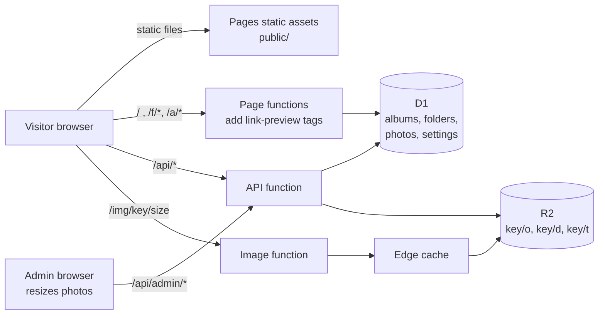

# Tiny Gallery

A small, fast photo gallery for **one photographer**, running entirely on Cloudflare's free tier:
Pages for the site, Pages Functions for the API, **D1** for the database and **R2** for the photos.
No framework, no build step, no npm dependencies: about 2,400 lines of plain JavaScript, HTML and CSS.

Minimal dark design: full-screen covers, a masonry grid, a clean photo viewer,
easy downloads, and private links for clients.

**Live demo:** <https://tinygallery.pages.dev/>
**Private client folder (demo):** <https://tinygallery.pages.dev/f/RtcvX8TEzivg>


| Albums on the home page | Private client folder |
|---|---|
|  |  |
| **Album grid** | **Photo viewer with share, download and zoom** |
|  |  |

**On a phone:** cover, album grid and viewer.


<!-- Admin panel screenshots: docs/screenshots/admin-*.jpg (to be added) -->

---

## Contents

- [Features](#features)
- [How it works](#how-it-works)
- [Deploy your own](#deploy-your-own)
- [Local development](#local-development)
- [Costs and limits](#costs-and-limits)
- [Custom domain and moving accounts](#custom-domain-and-moving-accounts)
- [Security and privacy](#security-and-privacy)
- [Known limitations](#known-limitations)
- [Project structure](#project-structure)
- [Credits](#credits) · [License](#license)

---

## Features

**For visitors**
- Full-screen cover with the site name, then album cards; each album opens with its own cover.
- Masonry grid that keeps left-to-right order (2 columns on phones, 3 on laptops, 4 on large screens).
- Photo viewer with keyboard arrows, swipe, **pinch / double-tap / wheel zoom** and drag to pan.
  Past the display resolution it quietly loads the original, so zoomed detail stays sharp.
- **Download** the original with its original file name, from the grid (hover) or the viewer.
- **Share** button: the device's own share sheet (phones, Safari, Chrome, Edge), copy-link fallback elsewhere.
- **Link previews** (WhatsApp, Messenger, Slack, ...) with title, description and cover photo.
- Self-hosted Montserrat font: no Google Fonts, no trackers, no cookies for visitors.

**For the photographer (admin at `/admin`)**
- One admin account, one password (a Cloudflare secret). No sign-ups, no user management.
- Albums with title and date, shown on the **home page**, **hidden**, or inside a **private folder**.
- Drag-and-drop upload of many photos at once. The browser makes the display (2400 px) and thumbnail (900 px)
  copies, the original is kept untouched for download.
- **Private folders** for clients: an unguessable link (`/f/<12 random characters>`), no password,
  collapsible list, **New link** button to revoke the old one.
- Cover photo chooser for the home page, each folder and each album.
- Search for albums and folders (ignores accents: "seinajoki" finds "Seinäjoki").
- Site name setting, storage used (with on-demand recount) and photo count.

---

## How it works



### Pieces

| Piece | What it does |
|---|---|
| `public/` | Static site served by Cloudflare Pages: one HTML shell for all public pages (`index.html`), the admin (`admin.html`), `app.js`, `admin.js`, `style.css`, fonts. Pages renders it in the browser. |
| `functions/api/[[path]].js` | JSON API. Public: `/api/home`, `/api/f/<token>`, `/api/album/<slug>`. Admin: everything under `/api/admin/*`. |
| `functions/img/[[path]].js` | Serves photos from R2 at `/img/<key>/<t\|d\|o>` (thumb, display, original), with year-long immutable caching and an edge cache. `?dl` forces a download with the original file name. |
| `functions/index.js`, `functions/f`, `functions/a` | Return the same HTML shell with Open Graph tags filled in on the server, because chat apps do not run JavaScript. |
| `lib/` | Shared code: page data and access rules (`data.js`), link previews (`og.js`), sessions and helpers (`util.js`). |
| **D1** (SQLite) | `albums`, `folders`, `photos`, `settings`, `login_attempts`. See [`schema.sql`](schema.sql). |
| **R2** | Three files per photo under a random 20-character key: `<key>/o` original, `<key>/d` display JPEG, `<key>/t` thumbnail JPEG. |

### URLs

| URL | Page |
|---|---|
| `/` | Home: public albums (folder_id empty and not hidden) |
| `/a/<slug>` | Public album |
| `/f/<token>` | Private folder: its albums, with the folder name on the cover |
| `/f/<token>/<slug>` | Album inside a private folder |
| `/admin` | Admin panel |

### Uploads

Resizing happens **in the admin's browser** (canvas, EXIF orientation applied), so the server never decodes
images and stays far below the 10 ms CPU limit of the free plan. Each photo is uploaded in three steps:

1. `POST /api/admin/albums/<id>/photos` returns a new random key.
2. `PUT /api/admin/upload/<key>/<t|d|o>` streams each file straight into R2 (the function never reads the bytes).
3. `POST /api/admin/albums/<id>/photos/<key>` checks all three files exist and adds the photo to the album.

A 22 MB original uploads in a few seconds this way.

### Access rules

- A **public** album opens for everyone.
- An album in a **private folder** opens only with that folder's token in the URL, otherwise "Not available".
- **Hidden** albums are visible to the admin only.
- Deleting a folder makes its albums **hidden**, never public, so nothing private leaks onto the home page.
- The admin can preview any album.

---

## Deploy your own

You need a Cloudflare account (free plan is fine), Node.js 18+ for `npx`, and R2 enabled in the dashboard
(R2 asks for a payment method even on the free tier).

```bash
git clone https://github.com/t0ma5/tinygallery.git
cd tinygallery
npx wrangler login
```

1. **Create the database and the bucket.** Use your own names if you like.
   ```bash
   npx wrangler d1 create tinygallery
   npx wrangler r2 bucket create tinygallery
   ```
2. **Edit `wrangler.toml`**: set `name` (your Pages project, it becomes `<name>.pages.dev`),
   `database_id` (printed by the previous step), `bucket_name`, and the default site name in `PHOTOGRAPHER`.
3. **Create the tables.**
   ```bash
   npx wrangler d1 execute tinygallery --remote --file schema.sql
   ```
4. **Create the Pages project.** The `--force` flag makes a classic Pages project with a `pages.dev` address.
   ```bash
   npx wrangler pages project create tinygallery --production-branch main --force
   ```
5. **Set the admin password.** You type it at the prompt; it is stored encrypted at Cloudflare.
   ```bash
   npx wrangler pages secret put ADMIN_PASSWORD --project-name tinygallery
   ```
6. **Deploy.** Run this again after every change, and after changing the password.
   ```bash
   npx wrangler pages deploy --project-name tinygallery --branch main
   ```
7. Open `https://<name>.pages.dev/admin`, log in, set the site name, create albums and upload.

To remove the GitHub icon from the footer, set `REPO_URL = ''` at the top of `public/app.js`.

---

## Local development

```bash
echo "ADMIN_PASSWORD=pick-a-local-test-password" > .dev.vars
npx wrangler d1 execute tinygallery --local --file schema.sql
npx wrangler pages dev public
```

Wrangler simulates D1 and R2 on your machine (`.wrangler/`), so local uploads never touch Cloudflare.
`.dev.vars` and `.wrangler/` are git-ignored.

---

## Costs and limits

**R2** (standard storage class) has no egress fees: views and downloads never cost bandwidth.

| | Free per month | After that |
|---|---|---|
| Storage | 10 GB | $0.015 per GB-month |
| Reads (Class B: each photo served from R2) | 10 million | $0.36 per million |
| Writes (Class A: 3 per uploaded photo, 1 per 1,000 files on a storage recount) | 1 million | $4.50 per million |

Originals take most of the space: a 24 MP JPEG is about 8 to 12 MB, so roughly 1,000 photos fit in 10 GB.
The edge cache keeps repeat views from reading R2 again.

**Pages Functions** (free plan): **100,000 requests a day** and 10 ms CPU per request. Every photo shown is one
function request, so the free plan handles roughly 3,000 album views a day. Over the limit, requests fail until
the next day (nothing is billed). Workers Paid ($5/month) raises it to 10 million a month. For very busy sites,
serving photos straight from R2 on a custom domain avoids function requests for images.

**D1** free limits (5 GB, millions of reads a day) are far beyond what a gallery uses.

---

## Custom domain and moving accounts

Use your own domain (Pages project → Custom domains) **before** sharing many client links.
`*.pages.dev` names belong to one project in one account, so moving to another account would break every
shared `pages.dev` link. With your own domain, a move is:

1. In the new account create D1, R2 and the Pages project, set `ADMIN_PASSWORD`, deploy.
2. Copy the photos: Cloudflare's R2 migration tool ("Super Slurper") or `rclone sync old:bucket new:bucket`.
   Keys stay the same, so the database needs no changes.
3. Pause uploads, copy the database (`wrangler d1 export ... --remote --output gallery.sql`, then
   `wrangler d1 execute ... --remote --file gallery.sql` in the new account), copy the latest photos again.
4. Test on the new `pages.dev` address, then move the custom domain.

Download names come from the database, so they survive copies that drop R2 metadata.

---

## Security and privacy

- **Admin login:** password compared via SHA-256 hashes in constant time; session is an HMAC-signed,
  `HttpOnly`, `Secure`, `SameSite=Strict` cookie valid for 30 days. The signing key is derived from the password,
  so **changing the password logs out every session**. 10 failed logins per IP lock that IP out for 15 minutes.
- **CSRF:** admin writes require a custom `x-admin` header that cross-site forms cannot send, on top of `SameSite`.
- **Private folders are link-only**: anyone who has the link can open it and forward it.
  Tokens are 12 random base62 characters (about 71 bits). Use **New link** to revoke.
  Folder pages send `X-Robots-Tag: noindex` and `Referrer-Policy: no-referrer`.
- **Photo files** live under 20-character random keys, so they cannot be enumerated.
- **EXIF:** originals are stored and downloaded exactly as uploaded, **including GPS location** if the camera
  recorded it. Display and thumbnail copies have no EXIF.

---

## Known limitations

- **HEIC** (iPhone) photos upload only from Safari; other browsers cannot decode them. Export as JPEG first.
- One admin, no roles, no client accounts or favourites.
- No photo reordering yet (photos keep upload order) and no ZIP download of a whole album.
- Interrupted uploads can leave a few orphan files in R2 (they never appear in an album).
- Storage used is counted on demand (Recount), not live.

---

## Project structure

```
tinygallery/
├── wrangler.toml          Pages config: project name, D1 and R2 bindings, default site name
├── schema.sql             D1 tables
├── functions/
│   ├── api/[[path]].js    JSON API (public + admin)
│   ├── img/[[path]].js    photo files from R2, edge-cached, downloads
│   ├── index.js           /        HTML + link-preview tags
│   ├── a/[[path]].js      /a/*     HTML + link-preview tags
│   └── f/[[path]].js      /f/*     HTML + link-preview tags
├── lib/
│   ├── data.js            page data and access rules
│   ├── og.js              Open Graph tags
│   └── util.js            sessions, tokens, JSON helpers
└── public/
    ├── index.html, app.js     public pages
    ├── admin.html, admin.js   admin panel
    ├── style.css
    ├── fonts/                 Montserrat (SIL OFL)
    ├── _headers, robots.txt
```

---

## Credits

- Font: [Montserrat](https://github.com/JulietaUla/Montserrat) by Julieta Ulanovsky and contributors,
  [SIL Open Font License](public/fonts/OFL.txt), via Fontsource.
- Demo photos from [Unsplash](https://unsplash.com/license) via [Lorem Picsum](https://picsum.photos), by
  Afroz Nawaf, Alan Haverty, Alejandro Escamilla, Aleks Dorohovich, Ales Krivec, Anton Sulsky, Artur Pokusin,
  Bartosz Bąk, Ben Moore, Bonnie Meisels, Brooklyn Morgan, Carli Jean, Charlie Foster, Christopher Sardegna,
  Daniel Robert, Dogancan Ozturan, Dominik Martin, Dorothee Hübner, Dorothy Lin, Forrest Cavale, Glen Carrie,
  Go Wild, Griffin Keller, How-Soon Ngu, Jeff Sheldon, John French, Jon Eckert, Jonas Lavoie-Levesque,
  Juskteez Vu, Justin Leibow, Kelley Bozarth, Kristian Karlsson, Lou Levit, Louis Pellissier, Lucas Löf,
  Marta Pawlik, Martin Staněk, Milada Vigerova, Nathalie Gouzée, Nicholas Swanson, Oisin Conolly, Pawel Kadysz,
  Philipp Henzler, Piotr Kwiatkowski, POR7O, RayBay, Rula Sibai, Ruxandra Mateiu, Ryan Mcguire,
  Sebastian Kostrubala, Sebastien Gabriel, Shane Colella, Sonja Langford, Thomas Lefebvre, Tirza van Dijk,
  Topich, Vadim Sherbakov, Wellington Sanipe, Zugr and Zwaddi. The photos are not part of this repository.

## License

[MIT](LICENSE)
